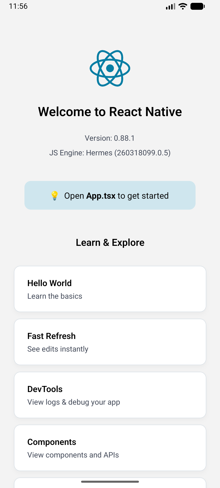
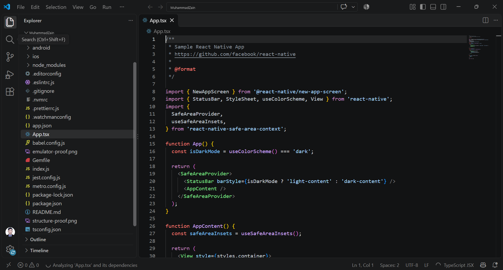

# MuhammadZain — React Native Setup

[](https://github.com/zainmustafam977/React-Native-Assignment-1/actions/workflows/ci.yml)
[](https://reactnative.dev)
[](#)
[](#)

**Course:** Mobile Application Development (MAD)
**University:** University of Management and Technology (UMT) — School of Systems and Technology (SST)
**Instructor:** M. Shahbaz Ali
**Assignment:** 1 — React Native project setup, run on the Android Emulator (20 marks)

---

## Overview

A production-structured React Native application scaffolded from the official
`@react-native-community/cli` template, built with Gradle, installed on an Android
Emulator, and verified end-to-end — JS bundle served by Metro, Hermes engine, native
app launching on device, lint and unit tests green.

The application renders the default React Native welcome screen, which is the exact
deliverable requested by the brief. No template code was replaced, so the proof
screenshots correspond one-to-one with the committed source.

| Item | Value |
| --- | --- |
| Application name | `MuhammadZain` |
| Android package | `com.muhammadzain` |
| React Native | 0.88.1 |
| React | 19.3.0 |
| JS engine | Hermes |
| Architecture | New Architecture enabled |
| TypeScript | strict config from `@react-native/typescript-config` |

---

## Proof of setup

<table>
  <tr>
    <td align="center" width="50%">
      <br />
      <sub><b>emulator-proof.png</b><br />Default React Native welcome screen running on the Android Emulator (captured from the device itself)</sub>
    </td>
    <td align="center" width="50%">
      <br />
      <sub><b>structure-proof.png</b><br />Project file structure — Android and iOS native projects, source files, and proof artifacts</sub>
    </td>
  </tr>
</table>

---

## Verified environment

Everything below was used for the build and the captured screenshots.

| Tool | Version |
| --- | --- |
| Node.js | 24.22.1 (project requires `>= 22.11.0`) |
| npm | 12.2.2 |
| JDK | OpenJDK 25.0.3 (Android Studio bundled JBR) |
| Gradle | 9.4.1 (wrapper) |
| Android NDK | 27.1.12297006 |
| CMake | 3.22.1 |
| compileSdk / targetSdk / minSdk | 37 / 36 / 24 |
| AVD | `Medium_Phone_API_37.0` (Android 15, x86_64, API 37) |

---

## Prerequisites

- Node.js `>= 22.11.0` and npm
- Android Studio with:
  - Android SDK Platform 37, Build-Tools 36.0.0, Platform-Tools
  - NDK 27.1.12297006 and CMake 3.22.1 (installed automatically by Gradle on first build)
  - An AVD (tested with `Medium_Phone_API_37.0`)
- `ANDROID_HOME` pointing at your SDK, and a JDK 17+ on `JAVA_HOME`
  (the JDK bundled with Android Studio works)

---

## Quick start

```bash
# 1. Dependencies
npm ci

# 2. Boot an emulator (or connect a physical device)
emulator -avd Medium_Phone_API_37.0

# 3. Build, install and launch on the running device
npm run android
```

`npm run android` starts Metro automatically. To run Metro in its own terminal instead:

```bash
npm start          # terminal 1
npm run android    # terminal 2
```

A debug build loads JavaScript from Metro over `adb reverse tcp:8081 tcp:8081`, so the
emulator must be able to reach the dev server. The first Gradle build downloads the
Gradle distribution, AGP, NDK and CMake and can take 15–30 minutes; later builds are
incremental and finish in minutes.

---

## Scripts

| Command | Description |
| --- | --- |
| `npm run android` | Build and install the debug app on a connected device, starting Metro |
| `npm start` | Start the Metro bundler only |
| `npm run lint` | ESLint over the whole project |
| `npm test` | Jest unit tests |
| `npx tsc --noEmit` | TypeScript type-check |

Continuous integration runs lint, type-check and tests on every push to `main`
(see `.github/workflows/ci.yml`).

---

## Project structure

```
.
├── .github/workflows/ci.yml   CI: lint, type-check, tests
├── android/                   Android native project (Gradle, Kotlin, manifest)
│   └── app/src/main/java/com/muhammadzain/
│       ├── MainActivity.kt    Android entry activity
│       └── MainApplication.kt Application host / ReactNativeHost
├── ios/                       iOS native project (Xcode)
├── __tests__/App.test.tsx     Jest render test
├── App.tsx                    Root React component
├── index.js                   Registers the app with AppRegistry
├── app.json                   App name and display name
├── metro.config.js            Metro bundler configuration
├── babel.config.js            Babel configuration
├── tsconfig.json              TypeScript configuration
├── package.json               Dependencies and scripts
├── emulator-proof.png         Proof: app running on the emulator
├── structure-proof.png        Proof: project structure
└── README.md
```

---

## How this was verified

1. `npm ci` — 857 packages installed, lockfile respected.
2. `cd android && ./gradlew app:installDebug` — **BUILD SUCCESSFUL** across all four
   ABIs (armeabi-v7a, arm64-v8a, x86, x86_64), APK installed on `emulator-5554`.
3. `adb shell am start -n com.muhammadzain/.MainActivity` — app process launched;
   `mCurrentFocus` confirms `com.muhammadzain/com.muhammadzain.MainActivity`.
4. Metro served the bundle on port 8081 and the welcome screen rendered, showing
   `Version: 0.88.1` and `JS Engine: Hermes`.
5. `npm run lint` — passes with no warnings.
6. `npm test -- --ci` — 1 suite / 1 test passing.

---

## Troubleshooting

**`Invalid file path` while configuring the Android build**
`android/local.properties` must use forward slashes on Windows:

```properties
sdk.dir=C:/Users/<you>/AppData/Local/Android/Sdk
```

**`ninja: error: Filename longer than 260 characters`**
Windows' default path limit is exceeded by NDK object files when the project sits deep in
the file system. Clone into a short path (for example `C:\dev\React-Native-Assignment-1`)
or build through a short drive mapping, e.g. `subst M: C:\long\path\to\project` and build
from `M:\android`. Enabling Windows long paths (`LongPathsEnabled`) also resolves it.

**Emulator shows "Allow MuhammadZain to find nearby devices?"**
React Native's dev tooling requests a runtime permission on first launch. Tap **Allow**, or
pre-grant it: `adb shell pm grant com.muhammadzain android.permission.NEARBY_WIFI_DEVICES`.

**App shows a red screen / cannot connect to Metro**
Run `adb reverse tcp:8081 tcp:8081` and make sure Metro is running (`npm start`).

---

## Assignment checklist

| Requirement | Status |
| --- | --- |
| New React Native project named after the student | `MuhammadZain` |
| Project opened in VS Code | `structure-proof.png` |
| App run on the Android Emulator | `emulator-proof.png` |
| Default React Native welcome screen reached | Confirmed in `emulator-proof.png` |
| Screenshots stored in the project root | `emulator-proof.png`, `structure-proof.png` |
| Git repository, `main` branch, pushed to GitHub | This repository |

## Repository

<https://github.com/zainmustafam977/React-Native-Assignment-1>

## References

- React Native — Get started: <https://reactnative.dev/docs/getting-started>
- Environment setup: <https://reactnative.dev/docs/set-up-your-environment>
- Android Studio emulator: <https://developer.android.com/studio/run/emulator>
